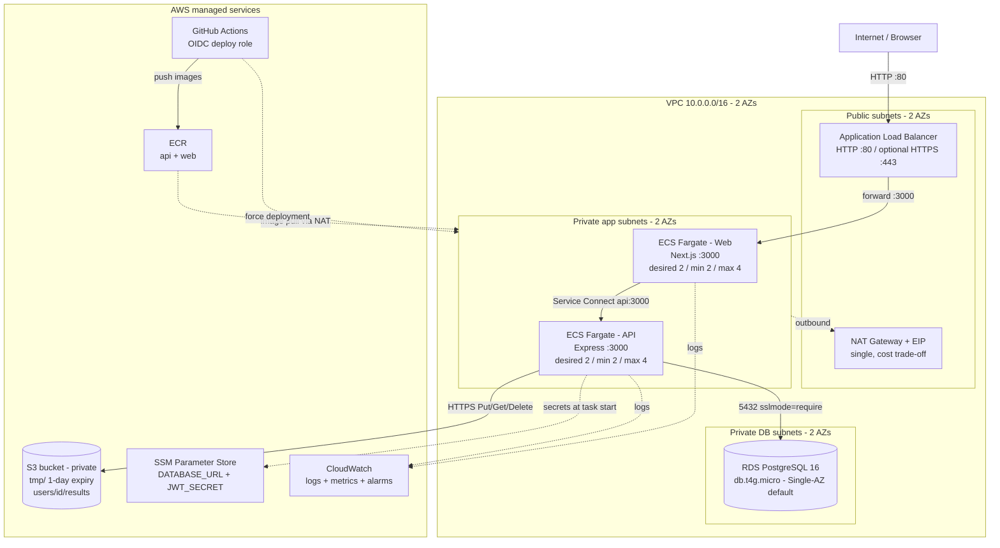

# Architecture — PDF Toolkit on AWS

The rendered diagram is available as `architecture.svg` (vector, editable) and
`architecture.png` (1500×1000 raster export, convenient for LaTeX/Word).
A Mermaid version follows for GitHub/Markdown viewers.

## Diagram

## Three tiers

| Tier | Compute | Network placement | Public access |
|---|---|---|---|
| Web | ECS Fargate service `pdf-toolkit-prod-web`, Next.js standalone | Private app subnets in 2 AZs | Only through the ALB |
| Application | ECS Fargate service `pdf-toolkit-prod-api`, Express | Private app subnets in 2 AZs | None; reachable only from the web SG |
| Data | RDS PostgreSQL 16 | Private DB subnets in 2 AZs | None; reachable only from the API SG |

PDF bytes live in S3; PostgreSQL stores only user and document metadata.

## Request paths

### Static page and server-rendered UI

1. Browser → ALB on port 80 (or 443 with ACM).
2. ALB target group `pdf-toolkit-prod-web` forwards to a web task on 3000.
3. Next.js serves the page and static assets.

### API call

1. Browser calls the same origin: `/api/...`.
2. The Next.js server rewrites `/api/:path*` to `http://api:3000/:path*`.
3. ECS Service Connect resolves `api` to a healthy API task through its local
   proxy. The API security group only accepts 3000 from the web security group.
4. The API reads/writes PostgreSQL and S3, then returns JSON or a streamed PDF.

### Upload → process → download

1. `POST /api/pdf/upload` stores the file under `tmp/<uuid>.pdf` and inserts a
   `temp` document row.
2. `POST /api/pdf/merge|split|organize` loads the owned temp document(s), processes
   them with `pdf-lib`, stores the output under
   `users/<userId>/results/<uuid>.pdf`, and inserts a `ready` row.
3. The temp object and row are deleted after a successful operation. A 1-day S3
   lifecycle rule is the backstop for failed uploads.
4. `GET /api/documents` lists only the caller's `ready` rows.
5. `GET /api/documents/:id/download` checks ownership and streams the object with
   `Content-Disposition: attachment`. No presigned URL or public bucket is needed.

### CI/CD

1. Push to `main` → GitHub Actions test job.
2. Deploy job assumes the Terraform-created OIDC role (no static keys).
3. Builds both images, pushes `latest` and the commit SHA to the two ECR repos.
4. Forces new ECS deployments and waits for both services to stabilize.

## Network and security boundaries

- **Internet-facing:** only the ALB (public subnets, ports 80/443).
- **Private app:** web and API tasks have no public IPs. The web SG accepts 3000
  only from the ALB SG; the API SG accepts 3000 only from the web SG.
- **Private data:** RDS accepts 5432 only from the API SG and has no Internet
  route.
- **Egress:** app tasks reach ECR/CloudWatch through the single NAT; S3 uses a
  free gateway endpoint so object traffic bypasses NAT.
- **Secrets:** `DATABASE_URL` and `JWT_SECRET` are SSM SecureString parameters,
  injected by ECS at task start. The execution role can read only those two
  parameters.
- **S3:** public access blocked, ACLs disabled, versioning and SSE enabled, and a
  policy denies non-TLS requests.
- **RDS:** storage encrypted, `rds.force_ssl=1`, `sslmode=require` in the app.
- **GitHub:** OIDC trust restricted to this repository on `main` or pull requests.

## Availability and scaling

- Two AZs for the ALB, web tasks, API tasks, and DB subnets.
- Desired 2 tasks per service; ECS spreads them across the app subnets.
- ALB health checks and ECS container health checks remove unhealthy tasks.
- ECS deployment circuit breaker rolls back failed deployments.
- Autoscaling: 60% average CPU for both services, plus 800 requests per target
  per minute for the web service; min 2, max 4.
- RDS automated backups (7 days). Multi-AZ is a Terraform variable and is the
  recommended production upgrade.

## Statelessness and data flow

- JWT is stored in an httpOnly cookie; no server-side session table is required,
  so any API task can serve any request.
- Documents are identified by database ids; S3 keys are derived from the user id
  and a UUID. There are no local disk dependencies.
- Uploaded temp files are cleaned up after processing and by lifecycle rules.

## Cost/availability trade-offs

- One NAT Gateway instead of one per AZ: saves about $33/month; the NAT is a
  single outbound dependency.
- RDS Single-AZ by default: free-tier eligible; Multi-AZ doubles the DB cost.
- Fargate sizing is deliberately small; CPU-bound PDF work may queue behind a
  busy task, which triggers CPU-based scaling.
- Container Insights and Performance Insights are off to control cost; CloudWatch
  logs, ALB metrics, ECS metrics, and two alarms are still enabled.

## Deployment status

Infrastructure code validates. The AWS apply, ECR image push, and console
screenshots are the next phase; see `CEA/notes/02-terraform-infrastructure.md`
and `CEA/screenshots/CHECKLIST.md`.
