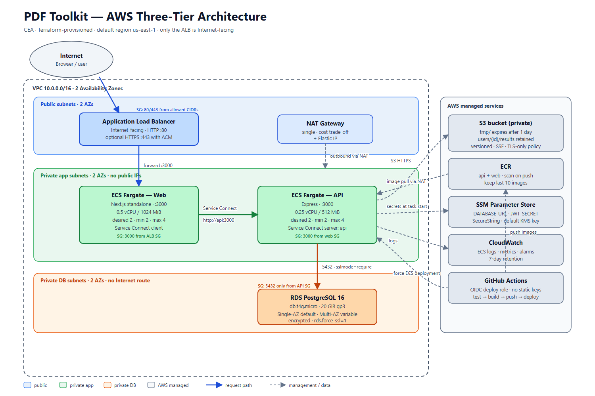
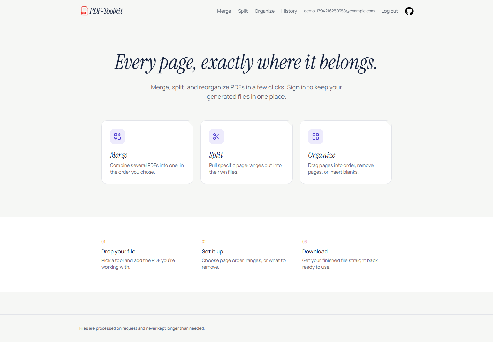
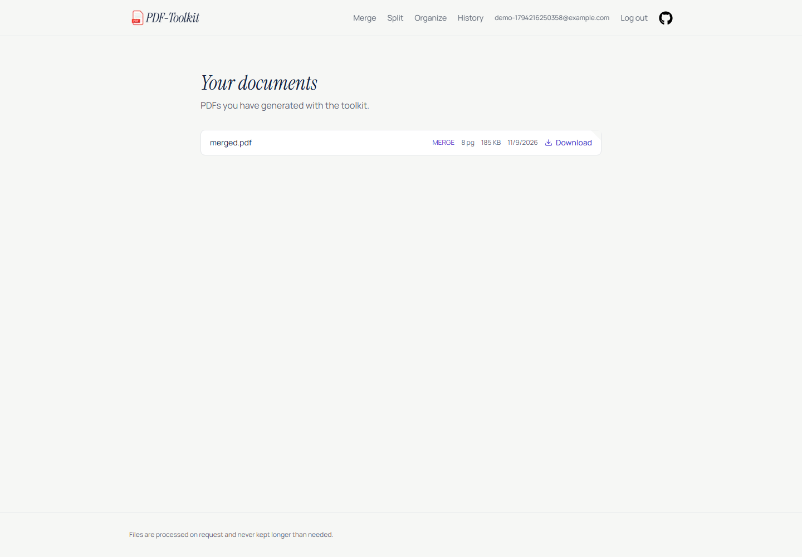
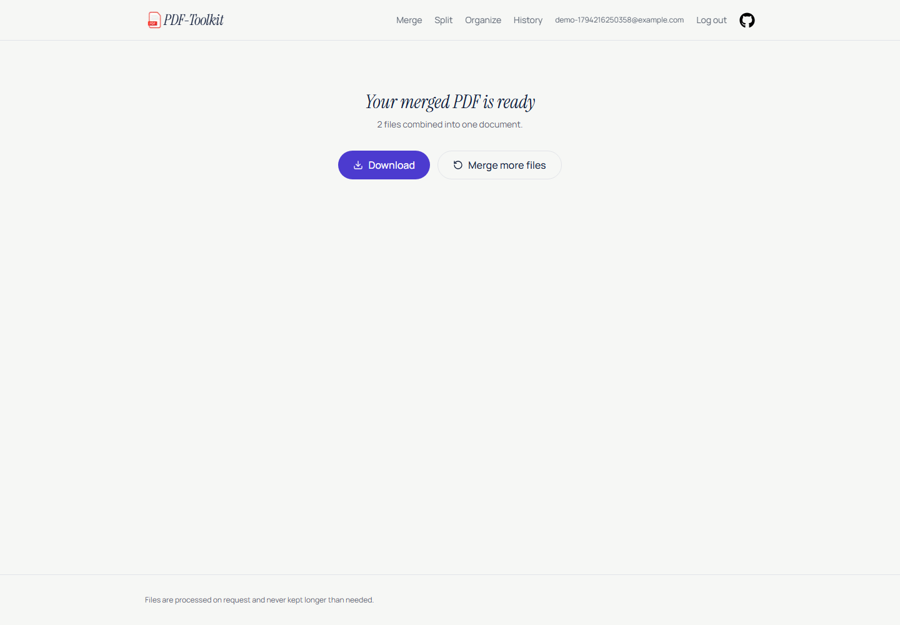

# Cloud-Native Three-Tier Deployment of PDF Toolkit on AWS — Extended Version

> **This is the extended reference version.** The 4–6 page submission is
> `technical-report.md`. This file keeps the long-form discussion, appendices,
> and reproduction commands for review and future maintenance.

**Course:** Cloud Computing (SE-490) — Complex Engineering Activity
**Student:** Muhammad Talha
**Roll number:** ____________________
**Date:** 2026-11-09
**Repository:** `https://github.com/MuhammadTalha57/pdf-toolkit`

---

## Abstract

PDF Toolkit is a small web application that merges, splits, and reorganizes PDF
files. Its original deployment used two Vercel projects and Vercel Blob: no
virtual network, no database, no authentication, no container registry, and no
CI/CD pipeline. This CEA converts it into a three-tier cloud-native system on
AWS. The web tier (Next.js) and application tier (Express) run as separate
containers on ECS Fargate in private subnets behind an Internet-facing
Application Load Balancer. The data tier is an RDS PostgreSQL instance in private
subnets, reachable only from the application tier. PDF bytes are stored in a
private S3 bucket, while PostgreSQL keeps users and document metadata. The web
tier proxies `/api/*` to the application tier through ECS Service Connect, so the
API has no public endpoint and the browser has a single origin. The stack is
provisioned with Terraform, built and deployed by GitHub Actions using OIDC
(no static AWS keys), and observed through CloudWatch. The application was
extended with cookie-based authentication and per-user document history so the
database tier has a real workload. The report maps every numbered requirement to
the implementation, analyses the non-functional properties, records the problems
encountered and their fixes, and gives a detailed cost estimate.

---

## 1. Introduction

### 1.1 Background

PDF Toolkit is a TypeScript monorepo (npm workspaces + Turborepo) with a Next.js
16 App Router frontend and an Express 5 API. Users select PDFs in the browser;
the API uses `pdf-lib` to merge, split, or reorder pages and returns the result.
The original deployment split the monorepo into two Vercel projects and stored
files in Vercel Blob.

### 1.2 CEA objective

The CEA requires a genuine three-tier deployment on a public cloud: a virtual
network with public and private subnets, a containerized web tier and application
tier, a managed database in private subnets, a container registry, a CI/CD
pipeline, a load balancer with autoscaling, layered security, at least one
additional cloud-native enhancement, and a justified non-functional assessment.

### 1.3 Scope and approach

The hosting model had to change, not just the database. Vercel is a PaaS: it
cannot expose VPCs, subnets, NAT gateways, security groups, load balancers, or
managed databases, and its serverless functions are not the "application tier in
private subnets" the brief asks for. The chosen target is AWS with ECS Fargate,
ALB, RDS PostgreSQL, S3, ECR, CloudWatch, SSM Parameter Store, and Terraform.
GitHub Actions provides CI/CD. The application work is intentionally lean —
authentication, per-user history, and object storage — while the bulk of the
effort is infrastructure and automation.

---

## 2. Existing system and gap analysis

| Aspect | Original | Required for CEA |
|---|---|---|
| Hosting | Two Vercel projects | Three tiers on cloud infrastructure the student controls |
| Network | Vercel-managed | VPC, public/private subnets, route tables, NAT, security groups |
| Compute | Serverless functions | Containerized web + application tiers |
| Database | None | Managed database in private subnets |
| File storage | Vercel Blob | Cloud-native object storage / managed service |
| Registry | None | Container registry |
| CI/CD | None | Automated build, test, push, deploy |
| Load balancing | Vercel edge | Load balancer with health checks and autoscaling |
| Security | PaaS defaults | Tiered network and identity controls |
| Users | Anonymous | Authentication and per-user data |

A single EC2 instance was rejected because it does not provide managed
availability, autoscaling, or a clean separation between the web and application
tiers. Kubernetes was rejected as excessive for this scope. ECS Fargate maps
directly to every requirement with minimal server operations.

---

## 3. Requirement-to-design mapping

| # | Requirement | Implementation |
|---|---|---|
| 1 | Network layer | VPC `10.0.0.0/16`; two public, two private app, and two private DB subnets across two AZs; IGW; one NAT Gateway + EIP; separate route tables; S3 gateway endpoint. Terraform `network.tf`. |
| 2 | Web tier | Next.js standalone container on ECS Fargate, private app subnets, only the ALB can reach port 3000. Terraform `ecs.tf`, `security.tf`. |
| 3 | Application tier | Express container on ECS Fargate, private app subnets, SG allows 3000 only from the web SG; web proxies `/api/*` over Service Connect `api:3000`. |
| 4 | Database tier | RDS PostgreSQL 16, private DB subnet group, SG allows 5432 only from the API SG, encrypted storage, `rds.force_ssl=1`, automated backups. |
| 5 | Container registry | Two ECR repositories (`api`, `web`), scan-on-push, AES256 encryption, keep the last 10 images. |
| 6 | CI/CD | `.github/workflows/ci-cd.yml`: install, type-check, 18 API tests, production build; on `main`, OIDC login, Buildx, push `latest` + commit SHA, force ECS deployment, wait for steady state. |
| 7 | Load balancing + autoscaling | Internet-facing ALB in two AZs, web target group with health checks; ECS service autoscaling at 60% CPU for both services plus 800 requests/target/min for web; desired 2, min 2, max 4. |
| 8 | Security | Private subnets, four-SG chain, least-privilege IAM, SSM SecureString secrets, S3 block-public + TLS-only policy, OIDC deploy role, helmet, rate limiting, PDF MIME check, ownership checks, UUID validation, no arbitrary-URL fetching. |
| 9 | Cloud-native enhancement | **S3 object storage** and **Terraform infrastructure as code** (plus ECS Service Connect and OIDC CI/CD as supporting enhancements). |
| 10 | NFR justification | Section 8 analyses scalability, availability, elasticity, security, maintainability, performance, cost, and portability with honest gaps. |

---

## 4. Architecture



*Figure 1 — Three-tier deployment. Vector source: `CEA/architecture/architecture.svg`.*

### 4.1 Component overview

| Component | Service | Role |
|---|---|---|
| Edge | Application Load Balancer | Public HTTP(S) entry point, health checks, target group |
| Web tier | ECS Fargate `pdf-toolkit-prod-web` | Next.js standalone, serves UI and proxies `/api/*` |
| App tier | ECS Fargate `pdf-toolkit-prod-api` | Express API, auth, PDF processing, history |
| Data tier | RDS PostgreSQL 16 | Users, documents, migration ledger |
| Object storage | S3 | Temporary uploads and generated results |
| Registry | ECR | Versioned API and web images |
| Secrets | SSM Parameter Store | `DATABASE_URL` and `JWT_SECRET` (SecureString) |
| Observability | CloudWatch | Logs, ECS/ALB metrics, alarms |
| IaC | Terraform | Reproducible network, compute, data, IAM, alarms |
| CI/CD | GitHub Actions + OIDC | Test, build, push, deploy without static keys |

### 4.2 Network design

- VPC `10.0.0.0/16` with DNS support and DNS hostnames.
- Two Availability Zones (default; configurable to three).
- Public subnets `10.0.0.0/24`, `10.0.1.0/24`: ALB, NAT Gateway, Elastic IP.
- Private app subnets `10.0.10.0/24`, `10.0.11.0/24`: ECS tasks.
- Private DB subnets `10.0.20.0/24`, `10.0.21.0/24`: RDS.
- Public route table → Internet Gateway; app route table → NAT; DB route table
  has only the local route.
- An S3 gateway endpoint is attached to the app route table, so object traffic
  does not consume NAT data processing.
- Only the ALB has a public address. Web, API, and RDS tasks/instances have no
  public IPs.

### 4.3 Web tier

The web tier is a Next.js production build using `output: "standalone"` in a
`node:20-alpine` image. It listens on port 3000 and is registered in the ALB web
target group. Its security group accepts 3000 only from the ALB security group.

`next.config.ts` rewrites `/api/:path*` to `${API_INTERNAL_URL}/:path*`, with
`API_INTERNAL_URL=http://api:3000` in ECS and `http://localhost:4000` for local
development. The browser therefore uses one origin (`/api`), which keeps cookies
same-origin and removes the need for cross-origin credentials.

### 4.4 Application tier

The API is an Express 5 container on port 3000. It is not attached to the ALB. It
registers with ECS Service Connect under the discovery name `api`; the web task
is a Service Connect client and resolves `api:3000` through its local proxy. The
API security group accepts 3000 only from the web security group, so even a
misconfigured client inside the VPC cannot reach it unless it is in the web tier.

The API is stateless: the JWT cookie identifies the user, and all persistent
state is in PostgreSQL or S3. Any task can serve any request.

### 4.5 Data tier

RDS PostgreSQL 16 (`db.t4g.micro`, 20 GiB gp3, Single-AZ by default) lives in the
private DB subnets. Its security group accepts 5432 only from the API security
group. Storage is encrypted, automated backups are retained for 7 days, and the
parameter group sets `rds.force_ssl=1`. The application connection string uses
`sslmode=require`. Multi-AZ is a Terraform variable and is the recommended
production upgrade.

### 4.6 Object storage

S3 stores PDF bytes, never PostgreSQL. The bucket is private (all public access
blocked, ACLs disabled, versioning and SSE enabled) and has a TLS-only bucket
policy. Keys are:

```text
tmp/<uuid>.pdf                     temporary upload, deleted after processing
users/<userId>/results/<uuid>.pdf  generated result, retained
```

A 1-day lifecycle rule expires leftover `tmp/` objects; noncurrent versions
expire after 30 days. The API task role can only read/write/list this bucket.

### 4.7 Request flows

1. **Page:** browser → ALB :80 → web target group → Next.js :3000.
2. **API:** browser → `/api/...` → Next.js rewrite → Service Connect → API :3000.
3. **Upload:** API stores `tmp/<uuid>.pdf`, parses it with `pdf-lib`, and inserts a
   `temp` document row.
4. **Process:** merge/split/organize loads the owned temp document(s), writes the
   result to `users/<userId>/results/<uuid>.pdf`, inserts a `ready` row, and
   deletes the temp object and row.
5. **History:** `GET /documents` returns only the caller's `ready` rows.
6. **Download:** `GET /documents/:id/download` checks ownership and streams the
   S3 object with `Content-Disposition: attachment`.

### 4.8 Deployment flow

GitHub Actions runs tests and builds on every pull request. On `main`, it assumes
the Terraform-created OIDC role, pushes both images to ECR (`latest` and the
commit SHA), forces new ECS deployments, and waits for both services to become
stable. Terraform owns the task definitions; CI only replaces the image behind
the `latest` tag. Rollback is either a previous SHA tag or a Terraform change.

---

## 5. Application design and changes

### 5.1 Backend refactor

Removed:

- `mongoose` (unused and unnecessary; the deployment uses raw SQL).
- `@vercel/blob` (replaced by S3).
- `@aws-sdk/s3-request-presigner` (downloads are streamed, not presigned).

Added:

- `pg` for PostgreSQL and SQL migrations.
- `jose` for HS256 JWTs.
- `bcryptjs` for password hashing.
- `@aws-sdk/client-s3` for object storage.
- `cookie-parser`, `helmet`, and `@types/pg`.

### 5.2 Authentication

- Passwords are hashed with bcrypt.
- The API signs a 7-day HS256 JWT with `JWT_SECRET`.
- The token is stored in the `pdf_token` cookie: `httpOnly`, `SameSite=Lax`,
  `Secure` only when `COOKIE_SECURE=true` (or TLS is configured), path `/`.
- `requireAuth` verifies the cookie and attaches `req.userId`.
- `GET /auth/me` restores the session on page load.
- Logout clears the cookie.

A stateless JWT was chosen over a session table so any Fargate task can serve any
request. The cookie is httpOnly, so JavaScript cannot read the token.

### 5.3 Data model

```sql
users (
  id            uuid primary key,
  email         text not null,
  password_hash text not null,
  created_at    timestamptz not null default now()
);
create unique index users_email_lower_idx on users (lower(email));

documents (
  id            uuid primary key,
  user_id       uuid not null references users(id) on delete cascade,
  kind          text not null check (kind in ('upload','merge','split','organize')),
  original_name text not null,
  s3_key        text not null,
  size_bytes    bigint not null,
  page_count    integer,
  status        text not null default 'temp' check (status in ('temp','ready')),
  operation     jsonb,
  created_at    timestamptz not null default now(),
  expires_at    timestamptz
);
create index documents_user_created_idx on documents (user_id, created_at desc);
create index documents_status_idx on documents (status);
```

Migrations are embedded SQL strings and applied by `runMigrations()` on API
startup. A PostgreSQL session-level advisory lock prevents two tasks from racing
when both start at once.

### 5.4 API

| Method | Path | Auth | Purpose |
|---|---|---|---|
| GET | `/health` | no | Health check |
| POST | `/auth/signup` | no | Create user and set cookie |
| POST | `/auth/login` | no | Authenticate and set cookie |
| POST | `/auth/logout` | no | Clear cookie |
| GET | `/auth/me` | yes | Current user |
| POST | `/pdf/upload` | yes | Multipart PDF → temp document id |
| POST | `/pdf/merge` | yes | `{ documentIds[] }` → result id |
| POST | `/pdf/split` | yes | `{ documentId, splits }` → result ids |
| POST | `/pdf/organize` | yes | `{ documentId, operations }` → result id |
| GET | `/documents` | yes | Current user's ready documents |
| GET | `/documents/:id/download` | yes | Ownership check and streamed PDF |

The API accepts **document ids**, never client-supplied URLs. This removes the
server-side request forgery (SSRF) risk that would exist if the API fetched a
user-provided URL.

### 5.5 Frontend

- `AuthProvider` calls `/auth/me` on load and exposes `user`, `login`, `signup`,
  and `logout`.
- `AuthGate` protects tool and history pages; unauthenticated users are sent to
  `/login`.
- New `/login`, `/signup`, and `/history` pages.
- The navbar shows the email, History, and Log out when signed in.
- Tool pages upload first, send document ids to the API, and download the
  returned result through `fetch` with credentials.
- The production build is a standalone Next.js server, not a static export,
  because the `/api` rewrite runs server-side.

### 5.6 Why downloads are streamed instead of presigned

The design considered presigned S3 URLs. Streaming through the API was chosen
because:

1. The API already checks document ownership; a stream keeps that check on every
   download.
2. Presigned URLs require S3 CORS configuration and expose a second origin to the
   browser.
3. The local MinIO endpoint and AWS S3 endpoint differ; a streamed proxy works
   identically in both environments.

The trade-off is that download bandwidth passes through Fargate and the NAT/S3
path. Results are small (tens to hundreds of KB), so this is acceptable for the
assignment.

---

## 6. Security

### 6.1 Network segmentation

| Source | Destination | Port | Purpose |
|---|---|---|---|
| Internet (`allowed_http_cidrs`) | ALB | 80 (443 with ACM) | Public entry |
| ALB SG | Web SG | 3000 | Forward UI traffic |
| Web SG | API SG | 3000 | Service Connect proxy |
| API SG | RDS SG | 5432 | PostgreSQL |
| API SG | S3 gateway endpoint | 443 | Object storage |
| App subnets | NAT Gateway | 443/80 | ECR, CloudWatch |

There is no route from the Internet to the web, API, or RDS security groups.

### 6.2 Identity and secrets

- **ECS execution role:** ECR pull, CloudWatch Logs, and read access to exactly
  two SSM parameters; `kms:Decrypt` is limited to the SSM service.
- **API task role:** `s3:PutObject`, `s3:GetObject`, `s3:DeleteObject`,
  `s3:ListBucket`, `s3:GetBucketLocation` on the document bucket only.
- **Web task role:** no AWS permissions.
- **GitHub deploy role:** ECR push to the two repositories and ECS
  `UpdateService`/`DescribeServices` on the two services; OIDC trust restricted
  to `repo:MuhammadTalha57/pdf-toolkit` on `main` or pull requests.
- **Secrets:** `DATABASE_URL` and `JWT_SECRET` are SSM SecureString parameters
  injected at task start. They are not baked into images and not stored in GitHub.

### 6.3 Data protection

- S3: public access blocked, ACLs disabled, versioning, AES256 encryption, and a
  bucket policy denying any request with `aws:SecureTransport=false`.
- RDS: encrypted storage, private subnets, `rds.force_ssl=1`, and
  `sslmode=require` from the application.
- Cookies: httpOnly and SameSite=Lax; `Secure` is enabled when TLS is configured.
- Passwords: bcrypt hashes; the API never returns them.

### 6.4 Application controls

- `helmet` security headers.
- Rate limit: 300 requests per 15 minutes per task.
- Upload limit: 10 MB; MIME must be `application/pdf`.
- `pdf-lib` parses the file, so invalid PDF content is rejected before storage.
- Every document read/write checks `user_id`; cross-user access returns 404/400.
- UUID validation prevents malformed ids from reaching PostgreSQL.
- No arbitrary-URL fetch (document ids only).
- CORS restricted to `FRONTEND_ORIGIN` with credentials; in practice the browser
  is same-origin through the Next.js proxy.
- `trust proxy = 1` so rate limiting sees the client IP behind the ALB.
- Deployment circuit breaker rolls back failed releases.

### 6.5 Honest gaps

- The default ALB is HTTP. Without a certificate, `COOKIE_SECURE=false`, so the
  auth cookie is not marked Secure. The Terraform variable supports TLS, but a
  domain/certificate is required.
- In-memory rate limiting is per task, not global; a shared store (Redis/ElastiCache)
  would be needed for strict global limits.
- No AWS WAF or Shield Advanced; the ALB is exposed to the public Internet.
- No automatic secret rotation.
- Local Terraform state contains the generated DB password and JWT secret; remote
  state with encryption is documented but not enabled by default.

---

## 7. Scalability, availability, and elasticity

**Scalability.** The tasks are stateless and horizontally scalable. The ALB
distributes requests across web tasks, and Service Connect distributes across API
tasks. The database is the shared state; indexes on `documents(user_id,
created_at)` and `users(lower(email))` support the main queries. S3 scales
independently of compute.

**Availability.** The ALB, web service, API service, and DB subnets span two AZs.
Desired count is 2, so each service survives the loss of one task or one AZ. ALB
health checks and ECS container health checks remove unhealthy targets. The
deployment circuit breaker rolls back failed releases. RDS takes automated
backups. The known single points are the single NAT Gateway (outbound) and the
Single-AZ RDS instance; both are documented cost trade-offs with one-variable
upgrades.

**Elasticity.** ECS Service Auto Scaling uses target tracking: 60% average CPU
for both services, and 800 requests per target per minute for the web service.
Min 2, max 4. PDF processing is CPU-bound, so CPU is a reasonable signal; a
queue-based architecture would be the next step for sustained load.

**Performance.** The web and API are separate services, so a slow PDF job does
not block static page delivery. The ALB uses least-outstanding-requests routing.
The API streams downloads instead of buffering them into JSON. The main
performance limit is Fargate task size and the 10 MB upload cap, both intentional.

---

## 8. Non-functional requirements analysis

| NFR | Design decision | Evidence | Gap / next step |
|---|---|---|---|
| Scalability | Stateless tasks, ALB, Service Connect, ECS autoscaling | 2 tasks per service, CPU/request policies | Shared DB is the eventual bottleneck; add read replicas or a queue |
| Availability | 2 AZs, desired 2, health checks, circuit breaker, backups | Terraform network/services, ALB target health | Single NAT and Single-AZ RDS by default |
| Elasticity | Target-tracking CPU and ALB request count | `ecs.tf` autoscaling policies | Scale-in cooldowns; no predictive scaling |
| Security | Private subnets, SG chain, least-privilege IAM, SSM, OIDC, S3 controls | Terraform security/IAM/S3; app middleware | HTTP default, no WAF, per-task rate limit |
| Maintainability | Docker images, Terraform, one workflow, migrations | Reproducible `docker compose` and `terraform validate` | Local state; no staging environment |
| Performance | Separate tiers, streaming downloads, small tasks | Local E2E download of 185 KB result | CPU-bound PDF work limited by task size |
| Cost | Single NAT, small Fargate tasks, Single-AZ RDS, lifecycle rules, 7-day logs | Cost estimate ≈ $131/month 24/7; ≈ $13 for 72 h | NAT + ALB dominate; Spot/Savings Plans can reduce compute |
| Portability | Standard Docker images; AWS specifics isolated in Terraform | Images run locally against Postgres + MinIO | S3/SSM/ALB are AWS-specific |

---

## 9. Testing and verification

### 9.1 Automated tests

`npm test --workspace api` runs 7 Vitest files and 18 tests covering:

- PDF merge, split, and organize services.
- PDF reading.
- S3/storage key and client behavior.
- Password hashing and JWT round-trip/tamper rejection.
- Document UUID validation (malformed ids never reach the database).

`npm run check-types --workspace web` and `npm run build --workspace web` pass.
`npm run build --workspace api` passes.

### 9.2 Local end-to-end verification

The full stack ran with Docker Compose (PostgreSQL, MinIO, API, web) from a clean
database:

| Test | Result |
|---|---|
| Health direct and through the web `/api` rewrite | 200 |
| Signup, login, `/auth/me` | 200, cookie works |
| Unauthenticated history | 401 |
| Two uploads → merge | 8 pages, result id |
| Split into two ranges | two 2-page results |
| Organize with a blank page | 3 pages |
| History | only ready results, newest first |
| Download | 200, `%PDF-`, full byte count |
| Cross-user download / merge | 404 / 400 |
| Cross-user history | empty |
| Malformed document id | 404 |
| S3 after processing | only `users/<id>/results/`; zero `tmp/` leftovers |
| Clean database startup | migration `001_init` applied once |

### 9.3 Application evidence (local Docker)







The remaining local screenshots (signup, login, merge/split/organize tools) are
in `CEA/screenshots/local/`.

### 9.4 AWS verification (to be completed after apply)

Insert and reference the console screenshots listed in
`CEA/screenshots/CHECKLIST.md`:

- VPC/subnets/route tables, security groups.
- ALB and healthy target group.
- ECS services and Service Connect.
- ECR images.
- RDS instance.
- S3 bucket controls.
- GitHub Actions run.
- CloudWatch logs and alarms.

Then repeat the manual flow against the ALB URL and record the results. The
implementation status at the time of writing is: application and infrastructure
code complete, local end-to-end verified, Terraform validated, AWS apply pending
credentials.

---

## 10. Deployment and operations

### 10.1 First deployment

```bash
cd infra/terraform
cp terraform.tfvars.example terraform.tfvars
terraform init
terraform apply
```

Then build and push the first images to the two ECR repositories (ECS cannot
become healthy before images exist). The exact commands are in
`infra/terraform/README.md`.

### 10.2 CI/CD

Add the `github_deploy_role_arn` output as the GitHub repository variable
`AWS_ROLE_ARN`. Every push to `main` then tests, builds, pushes `latest` and the
commit SHA, forces new ECS deployments, and waits for stability. Pull requests
run tests only.

### 10.3 Migrations

The API applies migrations on startup under a PostgreSQL advisory lock. A new
task waits if another task is migrating, then sees the migration already applied.
This is safe for rolling deployments.

### 10.4 Observability and runbook

- CloudWatch log groups `/ecs/pdf-toolkit-prod/api` and `.../web`, 7-day retention.
- Alarms: ALB 5xx > 20 in 5 minutes; API CPU > 80% for 10 minutes.
- ECS deployment circuit breaker with rollback.
- To investigate: check ECS service events, then the relevant log stream, then
  RDS/S3 health, then ALB target health.
- To roll back: redeploy the previous image SHA (or change `image_tag`), or use
  `terraform apply` to revert infrastructure.

### 10.5 Teardown

`terraform destroy` removes the stack. The defaults enable S3 force-destroy and
skip the final RDS snapshot for course cleanup; remove those defaults for
production data.

---

## 11. Cost

The detailed estimate is in `CEA/report/cost-estimate.md`. Summary for
`us-east-1`, 2 tasks per service, 24/7:

| Group | Approx. monthly |
|---|---:|
| ECS Fargate (API + web) | $54 |
| ALB (base + LCU) | $22 |
| NAT Gateway + public IPv4 + data | $37 |
| RDS `db.t4g.micro` + 20 GiB | $14 |
| S3, ECR, CloudWatch, transfer | $4 |
| **Total** | **≈ $131/month** |

With the 12-month free tier the estimate is about $113/month. A 72-hour grading
window with the default size is about $13; with 1 task per service and the free
tier it is about $8–11. Fargate Spot and a single task per service reduce the
demo profile further. The main cost driver is the network path (ALB + NAT), not
the database. A budget alarm and `terraform destroy` after evidence capture are
recommended.

---

## 12. Limitations and future work

1. **TLS/domain:** the default ALB is HTTP. Add an ACM certificate (and a Route 53
   record) and set `cookie_secure=true` for production.
2. **Single NAT:** one NAT Gateway is an outbound single point of failure; add one
   per AZ for higher availability.
3. **RDS Multi-AZ:** enable `db_multi_az=true` for a standby in a second AZ.
4. **Global rate limiting:** move the rate limiter to a shared store if strict
   global limits are required.
5. **WAF/Shield:** add AWS WAF managed rules for public exposure.
6. **Remote state:** move Terraform state to S3 + DynamoDB and enable state
   locking; local state contains secrets.
7. **Secret rotation:** rotate the JWT secret and DB password on a schedule (SSM
   or Secrets Manager rotation).
8. **Async processing:** for large PDFs, move processing to a queue + worker
   (SQS + ECS) to avoid tying up API tasks.
9. **Observability depth:** enable Container Insights/Performance Insights and
   add SNS notifications to the alarms.
10. **Staging environment:** duplicate the Terraform stack with a smaller size for
    pre-production testing.

---

## 13. Conclusion

The project moved PDF Toolkit from a PaaS deployment to a three-tier AWS
architecture with a real VPC, private application and database tiers, container
images in ECR, an ALB with autoscaling, S3 object storage, Terraform
infrastructure as code, and OIDC-based CI/CD. Authentication and per-user history
give the database a genuine role and exercise the security boundaries. Every
numbered CEA requirement is mapped to a concrete resource or code path, and the
NFR analysis states both the strengths and the deliberate trade-offs. The local
end-to-end verification and automated tests provide evidence that the application
works; the remaining step is the AWS apply and console evidence capture described
in the checklist.

---

## References

1. AWS, *Amazon ECS on AWS Fargate* — https://docs.aws.amazon.com/AmazonECS/latest/developerguide/
2. AWS, *Application Load Balancer* — https://docs.aws.amazon.com/elasticloadbalancing/latest/application/
3. AWS, *Amazon RDS for PostgreSQL* — https://docs.aws.amazon.com/AmazonRDS/latest/UserGuide/
4. AWS, *Amazon S3 security best practices* — https://docs.aws.amazon.com/AmazonS3/latest/userguide/security-best-practices.html
5. AWS, *IAM roles for GitHub Actions OIDC* — https://docs.aws.amazon.com/IAM/latest/UserGuide/id_roles_providers_create_oidc.html
6. HashiCorp, *Terraform AWS provider* — https://registry.terraform.io/providers/hashicorp/aws/
7. Next.js, *Standalone output* — https://nextjs.org/docs/app/api-reference/config/next-config-js/output
8. node-postgres, *Pool and connection strings* — https://node-postgres.com/

---

## Appendix A — Environment variables

| Variable | Where | Purpose |
|---|---|---|
| `NODE_ENV` | API, web | `production` in containers |
| `PORT` | API, web | 3000 in containers; 4000 local API default |
| `DATABASE_URL` | API (SSM SecureString) | PostgreSQL connection string |
| `JWT_SECRET` | API (SSM SecureString) | HS256 signing key, min 16 chars |
| `JWT_EXPIRES_DAYS` | API | Cookie/token lifetime, default 7 |
| `S3_BUCKET` | API | Document bucket |
| `AWS_REGION` | API | S3 region |
| `FRONTEND_ORIGIN` | API | Allowed CORS origin |
| `COOKIE_SECURE` | API | `true` only with HTTPS |
| `MAX_UPLOAD_MB` | API | Upload cap, default 10 |
| `API_INTERNAL_URL` | Web | API base for the Next.js rewrite |
| `NEXT_PUBLIC_API_BASE_URL` | Web build | Browser API base, `/api` |
| `S3_ENDPOINT` | API (local only) | MinIO endpoint |
| `S3_ACCESS_KEY_ID` / `S3_SECRET_ACCESS_KEY` | API (local only) | MinIO credentials |

AWS uses the ECS task role for S3 credentials, so no access keys are injected.

## Appendix B — Reproduction commands

```bash
# Local stack
docker compose build
docker compose up -d
docker compose ps

# Tests and builds
npm test --workspace api
npm run check-types --workspace web
npm run build --workspace web

# Infrastructure validation
cd infra/terraform
terraform fmt -recursive
terraform init -backend=false
terraform validate

# Deployment (after AWS credentials are configured)
cp terraform.tfvars.example terraform.tfvars
terraform apply
# build/push images (see infra/terraform/README.md)
aws ecs update-service --cluster pdf-toolkit-prod --service pdf-toolkit-prod-api --force-new-deployment
aws ecs update-service --cluster pdf-toolkit-prod --service pdf-toolkit-prod-web --force-new-deployment
```

## Appendix C — Screenshot index

- Local application evidence: `CEA/screenshots/local/01`–`10`.
- AWS console evidence (to capture): `CEA/screenshots/CHECKLIST.md`.
- Architecture: `CEA/architecture/architecture.svg` / `.png` (and the Mermaid
  source in `architecture.md`).
