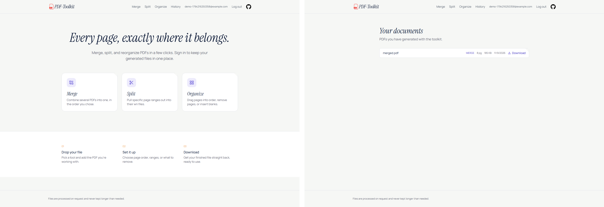

# Cloud-Native Three-Tier Deployment of PDF Toolkit on AWS

**Course:** Cloud Computing (SE-490) — Complex Engineering Activity  
**Student:** Muhammad Talha · **Roll number:** ____________________ · **Date:** 2026-11-09  
**Repository:** https://github.com/MuhammadTalha57/pdf-toolkit

## Abstract

PDF Toolkit merges, splits, and reorganizes PDF files. The original deployment was
two Vercel projects with Vercel Blob: no VPC, database, registry, authentication,
or CI/CD. This CEA rebuilds it as a three-tier AWS system. Next.js (web) and
Express (API) run as separate containers on ECS Fargate in private subnets behind
an Internet-facing ALB. RDS PostgreSQL holds users and document metadata; S3 holds
PDF bytes. The web tier proxies `/api/*` to the API through ECS Service Connect, so
the API has no public endpoint. Terraform provisions the stack and GitHub Actions
deploys it with OIDC and no static keys. Authentication and per-user history give
the database a real workload. Local end-to-end tests and 18 automated tests pass;
AWS apply and console evidence remain pending.

## 1. Provider choice and design

Vercel cannot expose the VPC, subnets, NAT, security groups, load balancer, or
managed database that the brief requires, so the platform had to change. AWS was
chosen because each requirement maps to a distinct, inspectable resource: VPC and
route tables, ALB and target groups, ECS services, RDS, ECR, S3, CloudWatch, and
IAM. Its Terraform provider and GitHub OIDC integration are mature, and the
account credits/free tier cover the grading window. Azure Container Apps and GCP
Cloud Run were considered, but their abstractions hide more of the network and
compute layers the assignment asks students to demonstrate.

The result is three tiers plus managed supporting services:

| Tier / service | Implementation | Role |
|---|---|---|
| Edge | Internet-facing ALB, two AZs | Public entry point, health checks, target group |
| Web | ECS Fargate `pdf-toolkit-prod-web`, Next.js standalone | UI and `/api/*` reverse proxy |
| Application | ECS Fargate `pdf-toolkit-prod-api`, Express | Auth, PDF processing, history, ownership checks |
| Data | RDS PostgreSQL 16, `db.t4g.micro`, 20 GiB gp3 | Users, documents, migration ledger |
| Objects | Private S3 bucket | `tmp/` uploads and `users/<id>/results/` outputs |
| Registry | Two ECR repositories | Versioned API and web images |
| Secrets | SSM Parameter Store SecureString | `DATABASE_URL`, `JWT_SECRET` |
| Operations | CloudWatch, Terraform, GitHub Actions | Logs/alarms, IaC, OIDC CI/CD |

## 2. Architecture

*Figure 1 — Network, tiers, data flow, and CI/CD. Vector source:
`CEA/architecture/architecture.svg`.*

The VPC is `10.0.0.0/16` across two AZs. Public subnets (`10.0.0.0/24`,
`10.0.1.0/24`) hold the ALB, one NAT Gateway, and its EIP. Private app subnets
(`10.0.10.0/24`, `10.0.11.0/24`) hold the Fargate tasks; private DB subnets
(`10.0.20.0/24`, `10.0.21.0/24`) hold RDS. The public route table points to the
Internet Gateway, the app table to the NAT, and the DB table has only the local
route. An S3 gateway endpoint keeps object traffic off the NAT. Only the ALB has a
public address.

A browser request reaches the ALB on port 80 (443 is optional with ACM) and is
forwarded to a web task on 3000. The Next.js server rewrites `/api/:path*` to
`http://api:3000/:path*`; ECS Service Connect resolves `api` through its local
proxy. The API security group accepts 3000 only from the web security group.
The API then uses RDS on 5432 (`sslmode=require`) and S3 over HTTPS. Downloads are
streamed by `GET /documents/:id/download` after an ownership check, so no bucket
object is public and no presigned URL is needed. Uploads go to `tmp/<uuid>.pdf`,
are parsed and inserted as `temp` rows, then processed into
`users/<userId>/results/<uuid>.pdf` and `ready` rows; the temp object and row are
deleted, with a 1-day S3 lifecycle rule as the backstop. The web and API are
stateless: the JWT cookie identifies the user, and all state is in PostgreSQL or
S3, so any task can serve any request.

Both services start at 2 tasks (min 2, max 4) and scale on 60% average CPU; the
web service also scales at 800 requests per target per minute. ALB and ECS health
checks remove unhealthy tasks, and the ECS deployment circuit breaker rolls back
failed releases. RDS takes 7-day automated backups; Multi-AZ is a Terraform
variable and the recommended production upgrade. The single NAT and Single-AZ RDS
are documented cost trade-offs, not oversights.

## 3. Containerization and CI/CD

Each tier has a multi-stage `node:20-alpine` Dockerfile. The API image installs
only the `api` workspace with `npm ci`, compiles TypeScript, and runs
`node dist/server.js`. The web image builds Next.js with `output: "standalone"`,
copies only the standalone server, static assets, and `public/`, and runs
`node apps/web/server.js`. The images are independent, so a frontend release does
not rebuild the API. `docker-compose.yml` runs web, API, PostgreSQL 16, and MinIO
locally; MinIO substitutes for S3 and the same S3 client code runs in both
environments.

GitHub Actions (`.github/workflows/ci-cd.yml`) has two jobs. The **test** job runs
on every push and pull request: `npm ci`, workspace type checks, 18 Vitest tests,
and a production build. The **deploy** job runs only on `main`, after tests. It
assumes a Terraform-created OIDC role (trust restricted to this repository and
branch), logs in to ECR, builds both images with Buildx, and pushes `latest` plus
the commit SHA. It then forces new ECS deployments and runs
`aws ecs wait services-stable`. No AWS access keys are stored in GitHub.

Terraform owns the task definitions; CI replaces the image behind `latest`. A
rollback is a redeploy of a previous SHA tag or a Terraform change. The API applies
SQL migrations on startup under a PostgreSQL advisory lock, so a rolling
deployment cannot run the same migration twice. CloudWatch receives both services'
logs (7-day retention), and two alarms cover ALB 5xx responses and sustained API
CPU.

## 4. Security

The controls are layered and least-privilege:

| Layer | Control |
|---|---|
| Network | Private app/DB subnets; ALB → web (3000), web → API (3000), API → RDS (5432) only; DB has no Internet route |
| Identity | ECS task roles: API can read/write only its bucket and read only its two SSM parameters; execution role limited to ECR, logs, and those parameters |
| Secrets | `DATABASE_URL` and `JWT_SECRET` are SSM SecureString, injected at task start; no credentials in images or Git |
| Data | RDS encrypted, `rds.force_ssl=1`; S3 public access blocked, ACLs disabled, versioning and SSE on, TLS-only bucket policy |
| Application | bcrypt password hashes, HS256 JWT in an httpOnly/SameSite=Lax cookie, helmet, rate limiting, PDF MIME/parse validation, UUID validation, per-user ownership checks, non-root containers |
| CI/CD | OIDC federation instead of static keys; deploy role restricted to the repository; pull requests cannot deploy |

Honest gaps: the default ALB is HTTP (TLS needs an ACM certificate and
`cookie_secure=true`); there is no WAF; rate limiting is per task, not global;
Terraform state is local and contains generated secrets; and secret rotation is
manual. Section 9 lists the mitigations.

## 5. Requirement mapping

| # | Requirement | Evidence |
|---|---|---|
| 1 | Network layer | VPC `10.0.0.0/16`; 2 public, 2 app, 2 DB subnets; IGW, one NAT + EIP, separate route tables, S3 endpoint (`network.tf`) |
| 2 | Web tier | Next.js container on Fargate in private app subnets; only ALB SG can reach 3000 (`ecs.tf`, `security.tf`) |
| 3 | Application tier | Express container on Fargate; 3000 only from web SG; Service Connect `api:3000` |
| 4 | Database tier | RDS PostgreSQL 16 in private DB subnets; 5432 only from API SG; encrypted, SSL required |
| 5 | Container registry | ECR `api` and `web`, scan-on-push, AES256, last 10 images (`ecr.tf`) |
| 6 | CI/CD | Tests, type checks, build; OIDC push of `latest` + SHA; force ECS deploy; wait for stability |
| 7 | Load balancing/scaling | ALB + target group + health checks; ECS autoscaling 60% CPU / 800 req/min; min 2, max 4 |
| 8 | Security | Four-SG chain, private subnets, least-privilege IAM, SSM secrets, S3/RDS controls, OIDC, app middleware |
| 9 | Enhancements | S3 object storage, Terraform IaC, CloudWatch monitoring, and a cost estimate (brief requires at least one) |
| 10 | NFR justification | Section 6 analyses all eight NFRs with gaps and next steps |

## 6. Non-functional requirements

| NFR | Design decision | Gap / next step |
|---|---|---|
| Scalability | Stateless tasks, ALB and Service Connect distribution, ECS autoscaling, indexed queries | Shared DB is the eventual bottleneck; add replicas or a queue |
| Availability | Two AZs, 2 tasks per service, health checks, circuit breaker, backups | Single NAT and Single-AZ RDS by default |
| Elasticity | Target tracking on CPU and ALB request count, min 2 / max 4 | No predictive scaling; scale-in cooldowns |
| Security | Private subnets, SG chain, least-privilege IAM, SSM, OIDC, S3/RDS controls | HTTP default, no WAF, per-task rate limit |
| Maintainability | One workflow, two Dockerfiles, Terraform, advisory-lock migrations | Local state; no staging environment |
| Performance | Separate tiers, streaming downloads, least-outstanding-requests ALB, small tasks | CPU-bound PDF work limited by task size; 10 MB upload cap |
| Cost | Single NAT, small tasks, Single-AZ RDS, S3 lifecycle, 7-day logs | NAT + ALB dominate; Spot/Savings Plans for compute |
| Portability | Standard images; AWS specifics isolated in Terraform and env vars | S3/SSM/ALB are AWS-specific; S3 API is widely portable |

## 7. Testing and evidence

`npm test --workspace api` runs 7 Vitest files and 18 tests: merge, split,
organize, PDF reading, storage key/client behavior, password/JWT round-trip and
tamper rejection, and UUID validation. Type checks and production builds pass for
both workspaces; `terraform fmt`, `init -backend=false`, and `validate` pass.

A clean `docker compose up` was verified end to end through the web origin:
health; signup/login/me; 401 without a cookie; upload; merge (8 pages); split (two
2-page files); organize (3 pages); history; download (HTTP 200, `%PDF-`, 188,960
bytes); cross-user download 404 and merge 400; invalid UUID 404; and zero `tmp/`
objects left after processing. Malformed document IDs are rejected before reaching
PostgreSQL, and migrations run once under the advisory lock.

*Figure 2 — Local application evidence: logged-in web tier and per-user history
(full set: `CEA/screenshots/local/`).*

The AWS apply, ECR first push, GitHub Actions run, and console screenshots are the
remaining evidence capture, blocked on AWS credentials. The exact capture list is
in `CEA/screenshots/CHECKLIST.md`; the report will be updated with the deployed
ALB URL and screenshots after apply.

## 8. Cost

Estimated `us-east-1`, 2 tasks per service, 24/7: Fargate $54, ALB $22, NAT +
IPv4 + data $37, RDS $14, S3/ECR/CloudWatch/transfer $4 — about **$131/month**.
With the 12-month free tier it is about $113/month; a 72-hour grading window is
about $13. Two optimizations: run one task per service for the demo (and use
Fargate Spot for non-critical work), and keep the single NAT/ALB only for the
grading window then `terraform destroy`; S3 lifecycle rules and 7-day logs already
prevent storage growth. The detailed table and assumptions are in
`CEA/report/cost-estimate.md`.

## 9. Limitations and conclusion

Known limitations: HTTP by default (add ACM + Route 53 and set
`cookie_secure=true`); one NAT (add one per AZ); Single-AZ RDS (set
`db_multi_az=true`); per-task rate limiting (use a shared store); no WAF or secret
rotation; local Terraform state (move to S3 + DynamoDB with encryption); and no
staging stack. Large PDFs would benefit from an SQS + worker queue instead of
holding an API task.

The project satisfies the CEA's three-tier, network, registry, CI/CD, load
balancing, security, enhancement, and NFR requirements with concrete resources
and code paths. The application works locally against the same container images,
Terraform validates, and the CI/CD pipeline is ready to run. The remaining step is
the AWS apply and evidence capture; the report states that gap explicitly rather
than claiming unverified results.

## References

1. AWS, *Amazon ECS on Fargate* — https://docs.aws.amazon.com/AmazonECS/latest/developerguide/
2. AWS, *Application Load Balancer* — https://docs.aws.amazon.com/elasticloadbalancing/latest/application/
3. AWS, *Amazon RDS for PostgreSQL* — https://docs.aws.amazon.com/AmazonRDS/latest/UserGuide/
4. AWS, *Amazon S3 security best practices* — https://docs.aws.amazon.com/AmazonS3/latest/userguide/security-best-practices.html
5. AWS, *IAM OIDC for GitHub Actions* — https://docs.aws.amazon.com/IAM/latest/UserGuide/id_roles_providers_create_oidc.html
6. HashiCorp, *Terraform AWS provider* — https://registry.terraform.io/providers/hashicorp/aws/
