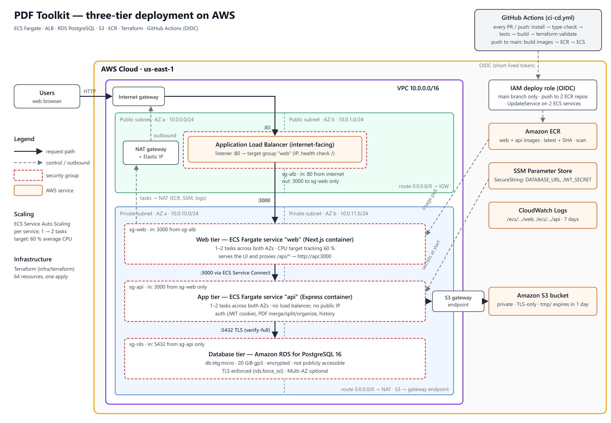

# Cloud-Native Three-Tier Deployment of PDF Toolkit on AWS

**Course:** Cloud Computing (SE-490) — Complex Engineering Activity
**Student:** Muhammad Talha · **Roll number:** ____________ · **Date:** ____________
**Repository:** https://github.com/MuhammadTalha57/pdf-toolkit

## Abstract

PDF Toolkit lets users merge, split and reorganise PDF files and keeps a
per-user history of results. This project deploys it as a containerised
three-tier system on AWS. A Next.js web container and an Express API container
run as separate ECS Fargate services in private subnets behind an
internet-facing Application Load Balancer; RDS for PostgreSQL stores users and
document metadata and S3 stores the PDF files. The whole environment (64
resources) is defined in Terraform, and a GitHub Actions pipeline tests every
change and, on `main`, pushes images to Amazon ECR and rolls the ECS services
using OIDC federation instead of stored AWS keys. The design deliberately uses
the smallest set of resources that still satisfies every CEA requirement.

## 1. Cloud provider and approach

**AWS** was chosen because every requirement in the brief maps to a distinct,
inspectable service (VPC, subnets, route tables, NAT, ALB and target groups,
ECS, RDS, ECR, S3, IAM, CloudWatch), its Terraform provider is mature, and
GitHub Actions integrates with it through OIDC. **ECS on Fargate** was chosen
over EC2 Auto Scaling Groups or EKS: it runs the containers without managing
hosts, its Service Auto Scaling is the horizontal-scaling equivalent of an ASG,
and it needs far fewer resources than a Kubernetes control plane plus node
groups. **Terraform** (infrastructure as code) and **S3** (object storage) are
the cloud-native enhancements, together with CloudWatch logging and the cost
estimate.

| Tier / role | Service | Responsibility |
|---|---|---|
| Entry | Application Load Balancer (public subnets, 2 AZs) | Single public endpoint, health checks, distributes to web tasks |
| Web tier | ECS Fargate service `web` — Next.js container | UI; proxies `/api/*` to the API |
| Application tier | ECS Fargate service `api` — Express container | Auth, PDF processing, history, ownership checks |
| Database tier | RDS PostgreSQL 16 `db.t4g.micro` | Users, documents, migrations |
| Object storage | S3 bucket | Uploaded (`tmp/`) and generated (`users/<id>/results/`) PDFs |
| Registry | Amazon ECR (`web`, `api`) | Versioned images (`latest` + commit SHA) |
| Secrets | SSM Parameter Store (SecureString) | `DATABASE_URL`, `JWT_SECRET` |
| Operations | CloudWatch Logs, Terraform, GitHub Actions | Logs, IaC, CI/CD |

## 2. Architecture

*Figure 1 — Network, tiers, security groups, data flow and CI/CD.*

**Network.** One VPC, `10.0.0.0/16`, spans two Availability Zones with one
public and one private `/24` subnet in each (`10.0.0.0/24`, `10.0.1.0/24`
public; `10.0.10.0/24`, `10.0.11.0/24` private). The public route table sends
`0.0.0.0/0` to the Internet Gateway; the private route table sends it to a
single NAT gateway, which the private tasks need for pulling images from ECR,
reading SSM parameters and shipping logs. An S3 gateway endpoint is attached to
the private route table so file traffic stays inside AWS. Only the ALB and the
NAT gateway have public addresses; nothing in the private subnets does.

**Request flow.** A browser sends `HTTP :80` to the ALB, which forwards to a
healthy web task on port 3000 (IP target group, health check `/`). The Next.js
server rewrites `/api/:path*` to `http://api:3000`; **ECS Service Connect**
resolves `api` to a healthy API task and load-balances across API tasks. The
API is not registered with the ALB and has no public route at all — it is
reachable only from the web tier. The API talks to RDS on 5432 with TLS and
full certificate verification (`sslmode=verify-full` against the AWS RDS CA
bundle baked into the image) and to S3 over HTTPS through the gateway endpoint.

**Data.** Uploads are validated and stored as `tmp/<uuid>.pdf` with a
`temp` row; operations write results to `users/<userId>/results/<uuid>.pdf`
as `ready` rows and delete the temporary inputs; a 1-day S3 lifecycle rule
removes anything left behind. Downloads are streamed by the API after an
ownership check, so the bucket stays private. Both containers are
**stateless** — identity is a JWT cookie and all state lives in RDS or S3 — so
any task can serve any request. Schema migrations run on API start-up under a
PostgreSQL advisory lock, which makes rolling deployments with several tasks
safe.

**Load balancing and scaling.** The ALB spreads requests across web tasks in
both AZs; Service Connect does the same for API tasks. Each service has an
Application Auto Scaling target (min 1, max 2 tasks — two lines in
`terraform.tfvars`) with a target-tracking policy at 60 % average CPU:
scale-out after 60 s above target, scale-in after a 300 s cooldown. ALB and
container health checks replace unhealthy tasks automatically.

## 3. Containerisation and CI/CD

Each tier has a multi-stage `node:20-alpine` Dockerfile built from the
monorepo root. The **API** image installs only the `api` workspace, compiles
TypeScript, adds the RDS CA bundle and runs `node dist/server.js`. The **web**
image builds Next.js in `standalone` mode and ships only the standalone server,
static assets and `public/`. Both run as the unprivileged `node` user and
expose port 3000. `docker-compose.yml` runs the same two images locally with
PostgreSQL 16 and MinIO (an S3-compatible stand-in), so the code paths are
identical locally and in AWS.

The pipeline (`.github/workflows/ci-cd.yml`) has two jobs:

1. **Build and test** — on every pull request and push: `npm ci`, type-check
   both apps, 18 Vitest unit tests, production builds, and
   `terraform fmt -check` / `terraform validate`.
2. **Push images and deploy** — only on `main`, after job 1 passes: obtain
   short-lived AWS credentials via OIDC, log in to ECR, build both images with
   Buildx (layer cache in GitHub), push `latest` and the commit SHA, force a new
   deployment of both ECS services, and wait for them to become stable.

ECS performs a rolling replacement behind the ALB and the **deployment circuit
breaker** rolls back automatically if new tasks fail their health checks.
Terraform owns the task definitions; CI only publishes images, so it needs no
`iam:PassRole`. Any build can be redeployed by its SHA tag (`image_tag`
variable). The first deployment is bootstrapped by creating the ECR
repositories, pushing initial images with `scripts/push-images.sh`, then
applying the rest (documented in `docs/DEPLOYMENT.md`).

## 4. Security

| Area | Control |
|---|---|
| Segmentation | ALB in public subnets; all containers and RDS in private subnets with no public IPs; RDS `publicly_accessible = false` |
| Security groups (per tier, least privilege) | `sg-alb`: in 80 from the internet, out 3000 to `sg-web` only · `sg-web`: in 3000 from `sg-alb`, out 3000 to `sg-api` + 443 · `sg-api`: in 3000 from `sg-web` only, out 5432 to `sg-rds` + 443 · `sg-rds`: in 5432 from `sg-api` only, no egress |
| Secrets | DB password and JWT secret generated by Terraform, stored as KMS-encrypted SSM SecureStrings, injected by ECS at task start; never in Git, images or CI |
| IAM | Execution role reads only the two parameters; API task role may only Get/Put/Delete objects in its bucket; web task has no AWS permissions |
| CI/CD | GitHub OIDC — no AWS keys stored in GitHub; the deploy role trusts only `repo:MuhammadTalha57/pdf-toolkit:ref:refs/heads/main` and may only push to the two ECR repositories and update the two ECS services; pull requests cannot deploy |
| Data | RDS storage encrypted, TLS enforced (`rds.force_ssl`) and verified by the client; S3 public access blocked, default encryption, policy denying non-TLS access; ECR scan on push |
| Application | bcrypt password hashes, HS256 JWT in an `httpOnly` `SameSite=Lax` cookie, helmet headers, rate limiting, upload size and PDF validation, UUID validation, per-user ownership checks, non-root containers |

## 5. Requirement mapping

| # | Requirement | Where it is met |
|---|---|---|
| 1 | Network layer | VPC `10.0.0.0/16`, 2 public + 2 private subnets, IGW, NAT, 2 route tables, S3 endpoint — `network.tf` |
| 2 | Web tier container, publicly accessible | Next.js image on Fargate behind the ALB — `apps/web/Dockerfile`, `ecs.tf`, `alb.tf` |
| 3 | App tier container, private, reachable only from web | Express image on Fargate, private subnets, `sg-api` admits only `sg-web` — `apps/api/Dockerfile`, `ecs.tf`, `security.tf`; `docker-compose.yml` for local orchestration |
| 4 | Managed database, not public | RDS PostgreSQL 16, private, `sg-rds` admits only `sg-api` — `rds.tf` |
| 5 | Container registry | Amazon ECR, two repositories — `ecr.tf` |
| 6 | CI/CD build, test, push, deploy | `.github/workflows/ci-cd.yml` |
| 7 | Load balancer, target group, horizontal scaling | ALB + `web` target group; ECS Service Auto Scaling 1–2 tasks per service — `alb.tf`, `ecs.tf` |
| 8 | Security | Section 4 — `security.tf`, `iam.tf`, `rds.tf`, `s3.tf` |
| 9 | Enhancements (≥ 1) | S3 object storage, Terraform IaC, CloudWatch logging, cost estimate with optimisations |
| 10 | NFR justification | Section 6 |

## 6. Non-functional requirements

| NFR | How the design addresses it | Not fully addressed / improvement |
|---|---|---|
| **Scalability** | Stateless containers; ALB and Service Connect distribute load; each tier scales independently; S3 scales without limits; indexed queries | One RDS instance is the eventual bottleneck → read replicas, connection pooling (RDS Proxy); max 2 tasks is a demo cap |
| **Availability / reliability** | Subnets and tasks spread over two AZs; ALB health checks and ECS replace failed tasks; circuit breaker rolls back bad releases; RDS automated backups; S3 is multi-AZ by design | With `min_tasks = 1` a task failure means a short gap until replacement; single NAT and Single-AZ RDS are single points of failure → `min_tasks = 2`, `db_multi_az = true`, one NAT per AZ |
| **Elasticity** | Target-tracking autoscaling adds tasks above 60 % CPU and removes them after load drops; nothing is statically sized for peak | Reactive only (≈ 1–2 min to add a task); CPU is the only signal → add request-count or schedule-based scaling |
| **Security** | Section 4: private subnets, chained per-tier SGs, least-privilege IAM, SSM secrets, OIDC CI, encrypted data, verified TLS to RDS | The public ALB serves HTTP only (no domain/certificate), so traffic from the browser is unencrypted and `COOKIE_SECURE=false` → ACM certificate + HTTPS listener; no WAF; rate limit is per task |
| **Maintainability / deployability** | Two Dockerfiles, one Terraform root module, one workflow; every merge to `main` is tested and deployed automatically with rolling updates and automatic rollback; SHA-tagged images for manual rollback | Local Terraform state (single operator) → S3 backend with locking; no separate staging environment |
| **Performance / latency** | ALB and tasks in the same region and AZs; web and API scale separately so CPU-heavy PDF work doesn't starve the UI; client-side page rendering (pdf.js) avoids round-trips; streaming downloads; S3 via gateway endpoint | 0.25 vCPU tasks process large PDFs slowly and hold a request open → larger tasks or an SQS-based worker; no CDN for static assets (CloudFront) |
| **Cost-efficiency** | ≈ $97/month (≈ $3.20/day): single NAT, free S3 endpoint, 1-task baseline with scale-out, smallest Fargate and RDS sizes, lifecycle rules, one-command teardown (see `cost-estimate.md`) | NAT + ALB + IPv4 are fixed costs (65 %) regardless of load; Graviton/Spot not used |
| **Portability** | Standard OCI images run unchanged under Docker Compose, ECS, or any Kubernetes; configuration is entirely environment variables; S3 access goes through the S3 API (works with MinIO); plain PostgreSQL | Terraform, IAM, SSM, Service Connect and the ALB are AWS-specific; moving clouds means rewriting the IaC, not the application |

## 7. Testing and deployment results

**Automated tests.** `npm test` runs 7 Vitest suites / 18 tests covering merge,
split, organize, PDF parsing, storage keys, password hashing, JWT signing and
tamper rejection, and UUID validation. Type-checks and production builds pass
for both apps; `terraform validate` passes and `terraform plan` produces 64
resources with no errors. These run in the pipeline's first job on every change.

**Local end-to-end.** With `docker compose up` the full flow was verified
through the web origin: signup / login / me, 401 without a cookie, upload,
merge, split, organize, history, download (valid `%PDF-` output), cross-user
access denied, malformed IDs rejected, and no `tmp/` objects left behind.

**AWS deployment.** *(Fill in after deploying with `docs/DEPLOYMENT.md`.)*

- `terraform apply` completed — screenshot of outputs.
- ALB URL: `http://__________________.us-east-1.elb.amazonaws.com`
- GitHub Actions run: link + screenshot of both jobs green.
- Console evidence: VPC/subnets, route tables, security groups, ALB/target
  group, ECS services and autoscaling, ECR images, RDS, S3 (list in the
  deployment guide).
- Application screenshots: signup, merge result, history, download.

## 8. Cost

The baseline costs about **$97/month** in us-east-1 (≈ $3.20/day), rising to
≈ $115 at full scale; the breakdown is in `cost-estimate.md`. Optimisations
applied: a single NAT gateway with a free S3 gateway endpoint (≈ $37/month
saved versus one NAT per AZ), and elastic right-sized compute — one 0.25 vCPU
task per service that scales to two only under load (≈ $18/month saved versus a
fixed two). Lifecycle rules cap storage, and the stack is destroyed when not in
use.

## 9. Limitations and conclusion

Known limitations, each with a clear upgrade path: HTTP-only public endpoint
(add an ACM certificate and HTTPS listener, then `COOKIE_SECURE=true`); single
NAT gateway and Single-AZ RDS (per-AZ NATs, `db_multi_az = true`); 1-task
minimum (`min_tasks = 2`); no WAF or CDN; per-task rate limiting; local
Terraform state; no staging environment; synchronous PDF processing.

The deployment meets every CEA requirement with a deliberately small footprint:
a two-AZ VPC with public/private segmentation, containerised web and
application tiers on ECS Fargate, a private managed PostgreSQL database,
images in ECR, a tested and automated GitHub Actions pipeline, an ALB with
autoscaling, least-privilege security throughout, S3 object storage and the
entire environment reproducible from Terraform with one documented procedure.

## References

1. AWS, *Amazon ECS Developer Guide* (Fargate, Service Connect, Service Auto Scaling).
2. AWS, *Elastic Load Balancing — Application Load Balancers*.
3. AWS, *Amazon RDS for PostgreSQL User Guide* (SSL/TLS, `rds.force_ssl`).
4. AWS, *Security best practices for Amazon S3*.
5. AWS, *Configuring OpenID Connect in AWS for GitHub Actions*.
6. HashiCorp, *Terraform AWS Provider documentation*.
