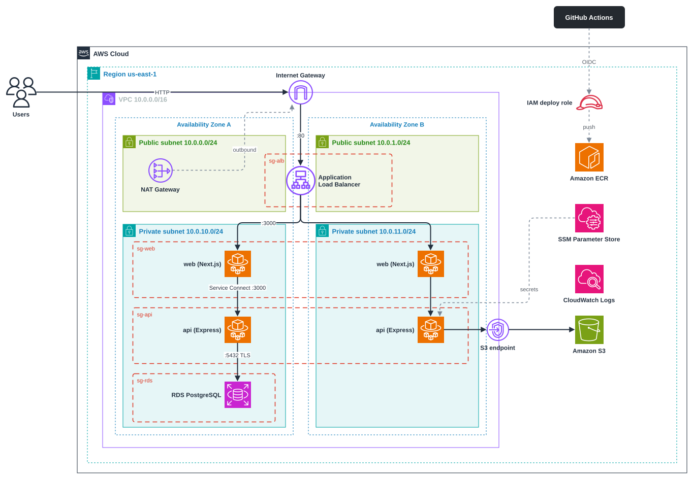

# PDF Toolkit

Merge, split and reorganise PDF files in the browser — deployed as a
containerised **three-tier application on AWS** with Terraform and a GitHub
Actions CI/CD pipeline.

| Tier | What runs there |
|---|---|
| **Web** | Next.js app (`apps/web`) in a Docker container on ECS Fargate, behind an Application Load Balancer |
| **Application** | Express API (`apps/api`) in a Docker container on ECS Fargate, reachable only from the web tier |
| **Database** | Amazon RDS for PostgreSQL 16 (users and document history) |
| **Files** | Amazon S3 (uploaded and generated PDFs) |

## Features

- **Merge** several PDFs in a chosen order.
- **Split** a PDF into page ranges.
- **Organize** pages: reorder by drag and drop, delete, insert blank pages.
- Accounts (email + password) with a per-user **history** of results to download again.

Page previews are rendered in the browser with `pdfjs-dist`; the actual PDF
work is done by the API with `pdf-lib`.

## Repository layout

```
apps/
  web/                Next.js 16 frontend (proxies /api/* to the API)
  api/                Express 5 API: auth, PDF operations, history
infra/terraform/      All AWS infrastructure as code
scripts/              push-images.sh / .ps1 — first image push to ECR
.github/workflows/    ci-cd.yml — build, test, push to ECR, deploy to ECS
docs/DEPLOYMENT.md    Step-by-step deployment guide (start here)
CEA/                  Course deliverables: report, cost estimate, diagram, evidence
docker-compose.yml    Full stack locally (PostgreSQL + MinIO + API + web)
```

## Architecture



- A browser talks only to the **ALB** (public subnets). The ALB forwards to the
  **web** tasks in the private subnets.
- The web server proxies `/api/*` to `http://api:3000` through **ECS Service
  Connect**. The API has no public endpoint; its security group admits only the
  web tier.
- The API stores metadata in **RDS** (TLS, verified certificate) and file bytes
  in **S3** (via a VPC gateway endpoint). Secrets come from **SSM Parameter
  Store** at task start.
- Each service autoscales on CPU between **1 and 2 tasks** (configurable).
- **GitHub Actions** authenticates to AWS with OIDC (no stored keys), pushes
  images to **ECR** and rolls the ECS services.

Design rationale, security controls and the NFR analysis are in
[`CEA/report/technical-report.md`](CEA/report/technical-report.md).

## Run locally

Requires Docker.

```bash
docker compose up --build
```

Open http://localhost:3000. MinIO stands in for S3 (console at
http://localhost:9001, `minioadmin` / `minioadmin`). Stop with
`docker compose down -v`.

### Without Docker (for development)

Requires Node 20+, plus PostgreSQL and MinIO from Compose:

```bash
npm install
docker compose up -d postgres minio minio-init
cp apps/api/.env.example apps/api/.env   # then set S3_ENDPOINT=http://localhost:9000 and the minioadmin keys
npm run dev                              # web on :3000, API on :4000
```

### Checks

```bash
npm run check-types
npm test
npm run build
```

## Deploy to AWS

Follow **[docs/DEPLOYMENT.md](docs/DEPLOYMENT.md)**. In short:

```bash
cd infra/terraform && terraform init
terraform apply -target=aws_ecr_repository.repo   # registries first
cd ../.. && ./scripts/push-images.sh               # first images (Windows: .\scripts\push-images.ps1)
cd infra/terraform && terraform apply              # everything else
```

After that, every push to `main` is tested and deployed automatically.
Remove everything with `terraform destroy`.

## Tech stack

Next.js 16 · React 19 · Tailwind CSS 4 · Express 5 · pdf-lib · pdfjs-dist ·
PostgreSQL 16 · AWS SDK v3 · Vitest · Docker · Terraform · GitHub Actions ·
AWS (VPC, ALB, ECS Fargate, ECR, RDS, S3, SSM, IAM, CloudWatch).
